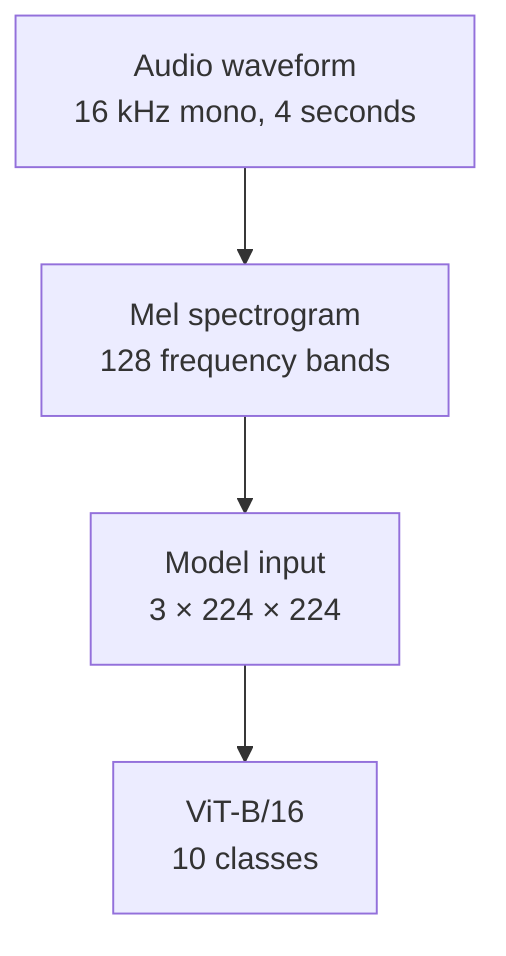

# Urban sound classification with a Vision Transformer

This project tests whether a model pretrained on images can classify environmental sounds. It converts audio clips into Mel spectrograms and fine-tunes torchvision's ImageNet-pretrained ViT-B/16 to recognize ten UrbanSound8K classes.

The best saved run reports **71.23% test accuracy on fold 10**, using the checkpoint selected by validation loss on fold 9. The repository contains the preprocessing notebook, training code, Slurm template, TensorBoard events, and logs behind that result.

Read the [method](#audio-to-image-method), [recorded results](#recorded-results), or [training instructions](#run-training). The [project guide](docs/project-guide.md) explains the original question, each transform, ViT patches, and the full workflow in more depth.

## The experiment

An audio waveform records amplitude over time. A Mel spectrogram represents how sound energy changes across time and frequency bands, giving an image model a two-dimensional input.

The experiment uses that representation to adapt an existing vision model. The new classifier predicts one sound class per clip. Most pretrained parameters stay frozen while the last two encoder layers and classifier learn from the sound labels.

The workflow combines audio preprocessing, edits to the training spectrograms, partial fine-tuning, and validation-based checkpoint selection. The saved jobs ran with CUDA on Mississippi State University's Ptolemy cluster.


This is an unchanged figure from [preprocessing.ipynb](preprocessing.ipynb). The training scripts generate tensors as the dataset returns examples. They do not train on exported PNG files.

## Audio-to-image method

[scripts/data.py](scripts/data.py) prepares each clip for the model.



Short clips receive zero padding at the end. For longer clips, preprocessing keeps the first four seconds. The Mel transform uses a 2,048-sample Fourier window and a 512-sample hop, then converts power to decibels with an 80 dB range limit.

The spectrogram is copied into three channels, resized to 224 × 224, and normalized with ImageNet channel statistics. The channels initially contain the same frequency information. The code applies normalization directly to decibel values without first scaling them into the interval from zero to one.

The resulting batch contains `pixel_values` with shape `[B, 3, 224, 224]` and integer `labels` with shape `[B]`. ViT-B/16 divides each image into 196 patches of 16 × 16 pixels.

### Training augmentation

The current training path uses these transforms.

| Transform | Where it runs | Setting and effect |
| --- | --- | --- |
| Frequency masking | Decibel spectrogram, before resizing | `freq_mask_param=25`. Replaces a sampled band of frequency rows with zero. |
| Time masking | Decibel spectrogram, before resizing | `time_mask_param=40`. Replaces a sampled interval of time columns with zero. |
| MixUp | Normalized training batch | `alpha=0.2`. Blends two inputs and their labels. |
| CutMix | Normalized training batch | `alpha=1.0`. Replaces a rectangle with part of another input and mixes labels by area. |

The engine selects either MixUp or CutMix for each training batch. Mixed labels contain ten class weights per example. Validation and test batches skip all four random transforms.

A zero-filled mask changes the spectrogram's numeric values. It does not remove samples from the waveform or guarantee acoustic silence. Gain changes, colored noise, pitch shifts, and shifts in time are also defined in the code, but are inactive in the current training path.

The [augmentation schematic and explanation](docs/project-guide.md#what-the-training-transforms-change) show how these operations differ from cropping audio or limiting the decibel range.

### Model and optimization

[scripts/model.py](scripts/model.py) loads `torchvision.models.vit_b_16` with `ViT_B_16_Weights.DEFAULT`. It replaces the original image classifier with dropout and a ten-output linear layer.

The following settings describe the current code with the default two-layer configuration.

| Component | Setting |
| --- | --- |
| Trainable parameters | New classifier and the last two of twelve encoder layers. The remaining pretrained parameters stay frozen. |
| Classifier | Dropout probability `0.5`, then a linear layer with ten outputs. |
| Optimizer | AdamW with weight decay `0.05`. |
| Initial learning rates | Classifier `2e-4`. Trainable encoder layers `1e-5`. |
| Loss | Cross-entropy with label smoothing `0.1`. |
| Learning-rate schedule | Cosine annealing over the requested epoch count, with `eta_min=1e-6`. |
| Numeric precision | Float16 autocast. Gradient scaling is enabled on CUDA. |
| Checkpoint selection | Lowest validation loss. |
| Early stopping | Twenty consecutive epochs without a lower validation loss. |

The classifier predicts one of ten classes by the largest output score. The project does not include event localization, speech transcription, or a deployed inference demo.

## Dataset and split

The loader uses Hugging Face Datasets to read `danavery/urbansound8K` with `streaming=False`. The saved jobs contain 8,732 clips divided by the supplied fold assignments.

| Purpose | Folds | Clips | Role |
| --- | --- | ---: | --- |
| Training | 1 through 8 | 7,079 | Update the trainable weights. |
| Validation | 9 | 816 | Select the checkpoint and control early stopping. |
| Test | 10 | 837 | Evaluate the selected checkpoint after training. |

The ten labels are `air_conditioner`, `car_horn`, `children_playing`, `dog_bark`, `drilling`, `engine_idling`, `gun_shot`, `jackhammer`, `siren`, and `street_music`.

If the dataset lacks a `fold` column, the loader falls back to a seeded random split with 80% for training, 10% for validation, and 10% for testing. That fallback is a different evaluation setup.

## Recorded results

The following jobs finished on May 11, 2025. Both used CUDA, 32 data-loader workers, and a maximum of 500 epochs. Both stopped early and reloaded their selected checkpoints before evaluating fold 10.

| Run log | Batch size | Epochs completed | Selected epoch | Test loss | Reported test accuracy |
| --- | ---: | ---: | ---: | ---: | ---: |
| [44101](train_44101.out) | 64 | 71 | 51 | 1.2032 | 71.23% |
| [44099](train_44099.out) | 128 | 110 | 90 | 1.2169 | 69.89% |

Job 44101 selected epoch 51 with validation loss `1.2262`. Training stopped after epoch 71, following twenty epochs without a lower validation loss.


The chart comes from [train_44101.out](train_44101.out). The corresponding TensorBoard loss and accuracy records match the text log to its printed precision.

The job headers request a classifier learning rate of `8e-5`. The matching [TensorBoard event file](runs/urbansound8k/events.out.tfevents.1746971580.ptolemy-gpu-04.3339684.0) records the first post-epoch classifier rate at approximately `2e-4`, consistent with the override in the current code. Requested flags alone do not establish which settings took effect.

### Interpretation and limits

These results show that the saved experiment classified audio through a vision model and a spectrogram representation. They do not establish a comparison with an audio-specific model or measure the benefit of each transform separately.

The evaluation has several limits.

- The reported result uses one held-out fold. It is not an average across ten-fold cross-validation.
- The engine averages loss and accuracy across batches. A smaller final batch receives the same weight as a full batch, so the reported accuracy is not an exact sample-weighted score.
- Training accuracy uses the largest component of each mixed label. It differs from accuracy on unmodified examples.
- The logs do not preserve the exact source revision or package versions. Historical results are not a guarantee of a fresh run.

The [error logs](train_44101.err) also show that the saved job used a cached dataset after a Hub lookup failed. Fresh dataset access and dependency compatibility need verification in the environment where you run the project.

## Run training

The saved cluster jobs used Python 3.10 and CUDA. [requirements.txt](requirements.txt) lists the dependencies without version pins. The commands below describe the repository's setup path, rather than a locked reproduction of the historical environment.

1. Clone the repository.

   ```bash
   git clone https://github.com/spicyneutrino/audio-classification-using-ViT.git
   cd audio-classification-using-ViT
   ```

2. Create an environment and install the dependencies.

   ```bash
   python3.10 -m venv venv
   source venv/bin/activate
   python -m pip install --upgrade pip
   python -m pip install -r requirements.txt
   ```

   Use compatible builds of `torch`, `torchvision`, and `torchaudio` for your CUDA installation. Preprocessing expects decoded audio values with `array` and `sampling_rate` fields. Check that interface when choosing a `datasets` version.

3. Set cache locations and download the dataset and pretrained weights.

   ```bash
   export HF_HOME="$PWD/.cache/huggingface"
   export TORCH_HOME="$PWD/.cache/torch"
   python download_dataset.py
   python download_model.py
   ```

   `download_dataset.py` requires `HF_HOME`, and `download_model.py` requires `TORCH_HOME`. The first downloads need network access. For a cluster, use shared storage that compute nodes can read and keep the same cache paths in the job environment.

4. Start training with an explicit worker count.

   ```bash
   python train.py --num_epochs 100 --batch_size 64 --num_workers 4
   ```

   The script prints the device and split sizes, reports metrics after each epoch, reloads the selected checkpoint, and prints final test loss and accuracy. If the checkpoint file is missing, it evaluates the final model instead.

   Device selection prefers CUDA, then MPS, then CPU. The committed logs demonstrate CUDA execution. CPU and MPS execution have not been verified for this documentation.

5. Inspect the metrics.

   ```bash
   tensorboard --logdir runs/urbansound8k
   ```

   New runs share the log directory with the committed experiments. The `Loss`, `Accuracy`, and `Learning Rate` tags record epoch metrics.

### Run on Slurm

[slurm.sh](slurm.sh) contains the Ptolemy job configuration. It requests one A100 GPU slice with 10 GB of memory, 32 CPUs, 128 GB of RAM, and a 12-hour limit.

Edit the partition, account, GPU request, module commands, project path, and cache paths for your cluster before submission. Prepare the caches where network access is available. The template requests 500 epochs, batch size 64, and a worker count from `SLURM_CPUS_PER_TASK`.

```bash
sbatch slurm.sh
```

Slurm writes progress and diagnostics to `train_<job-id>.out` and `train_<job-id>.err`. The Python code and checkpoint criterion are the same as for local training.

## Current configuration limits

The command-line parser exposes the following options. Some requested values do not reach the implementation, so the distinction matters for experiments.

| Option | Parser default | Current behavior |
| --- | --- | --- |
| `--num_epochs` | `10` | Maximum epoch count and cosine schedule duration. Early stopping can end training sooner. |
| `--batch_size` | `32` | Batch size for training, validation, and test loaders. |
| `--num_workers` | Half the detected CPU count, rounded down | Workers per loader. Set this for your machine or job allocation. |
| `--head_lr` | `8e-5` | Overwritten with `2e-4` in `train.py`. |
| `--encoder_lr` | `1e-5` | The CLI value is ignored. `train.py` fixes the rate at `1e-5`. |
| `--num_unfrozen_encoder_layers` | `2` | The model always unfreezes its last two encoder layers, but the optimizer uses the requested count. Keep the default to avoid a mismatch. |
| `--use_time_augment` | `True` | Not passed to dataset preprocessing, so it has no effect on training inputs. |

The optional waveform augmentation block also stores the original waveform before creating an augmented one. Enabling that block alone would still leave the original waveform in the batch.

The seed is set to 42 for NumPy and PyTorch. CUDA training also enables cuDNN benchmarking. The repository does not establish bit-for-bit reproducibility across environments or hardware.

## Outputs and repository guide

Each run writes its selected checkpoint to `checkpoints/best_model_<run-identifier>.pth`. The identifier uses a Slurm job ID and timestamp, or a local timestamp. Checkpoints contain model and optimizer state, the selected epoch, and its training and validation metrics. They are excluded from Git.

The repository contains the following implementation and evidence.

| Path | Contents |
| --- | --- |
| [train.py](train.py) | Arguments, device selection, data loaders, optimizer setup, checkpoint loading, and final test. |
| [scripts/data.py](scripts/data.py) | Dataset splits, waveform preparation, Mel conversion, and spectrogram transforms. |
| [scripts/model.py](scripts/model.py) | Pretrained ViT-B/16, replacement classifier, and trainable layers. |
| [scripts/engine.py](scripts/engine.py) | Batch mixing, weight updates, evaluation, checkpoint selection, and TensorBoard metrics. |
| [download_dataset.py](download_dataset.py) and [download_model.py](download_model.py) | Dataset and model cache preparation. |
| [slurm.sh](slurm.sh) | Cluster resources, environment setup, and training command. |
| [preprocessing.ipynb](preprocessing.ipynb) | Exploratory preprocessing, saved spectrograms, and model summaries. Some settings differ from the scripts. |
| [runs/urbansound8k/](runs/urbansound8k/) | TensorBoard events from multiple saved experiments. |
| [train_44101.out](train_44101.out) and [train_44099.out](train_44099.out) | Job settings, epoch metrics, checkpoint messages, and final results. |
| [train_44101.err](train_44101.err) and [train_44099.err](train_44099.err) | Dataset cache messages, progress output, and tracing warnings. |
| [docs/project-guide.md](docs/project-guide.md) | Detailed explanation of the experiment, transforms, model, and workflow. |

[docs/generate_training_curve.py](docs/generate_training_curve.py) regenerates the validation SVG with `python docs/generate_training_curve.py`. [docs/generate_guide_assets.py](docs/generate_guide_assets.py) extracts the unchanged notebook images and regenerates the augmentation schematic with `python docs/generate_guide_assets.py`.

## License and credits

The project code uses the [MIT license](LICENSE). The code license does not cover the dataset or pretrained weights.

Thanks to the UrbanSound8K creators and Mississippi State University's High Performance Computing Collaboratory for access to the Ptolemy supercomputer.
