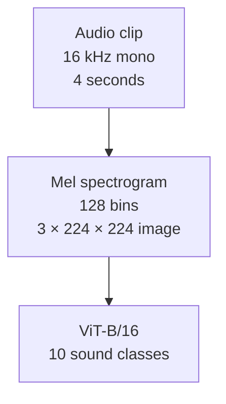

# Urban sound classification with a Vision Transformer

This project fine-tunes an ImageNet-pretrained Vision Transformer to classify urban sounds. It converts audio into Mel spectrograms, images of sound energy across time and frequency, and trains a ten-class classifier with PyTorch and torchvision.

The best saved run reports **71.23% test accuracy on UrbanSound8K fold 10**. This is a historical result from [job 44101](train_44101.out), not an average across all ten folds.

## Audio-to-image pipeline

The runnable pipeline lives in [scripts/data.py](scripts/data.py), [scripts/model.py](scripts/model.py), and [scripts/engine.py](scripts/engine.py).



Preprocessing pads or crops audio to four seconds, converts spectrogram power to decibels, and applies ImageNet normalization. Training masks frequency bands and time steps before image resizing. The engine also applies either MixUp or CutMix to each training batch. MixUp blends examples and their labels. CutMix replaces image regions and mixes labels.

The classifier uses dropout of `0.5` followed by a linear layer. Training uses AdamW, weight decay of `0.05`, label smoothing of `0.1`, and a cosine learning-rate schedule. The engine uses automatic mixed precision and saves the checkpoint with the lowest validation loss. It stops after 20 epochs without a lower validation loss.

## Dataset and split

[scripts/data.py](scripts/data.py) loads `danavery/urbansound8K` through Hugging Face Datasets with `streaming=False`. The saved runs contain 8,732 clips in these groups.

| Purpose | Folds | Clips |
| --- | --- | ---: |
| Training | 1 through 8 | 7,079 |
| Validation | 9 | 816 |
| Test | 10 | 837 |

If the dataset lacks a `fold` column, the loader falls back to a seeded random split with 80% for training, 10% for validation, and 10% for testing.

The ten labels are `air_conditioner`, `car_horn`, `children_playing`, `dog_bark`, `drilling`, `engine_idling`, `gun_shot`, `jackhammer`, `siren`, and `street_music`.

## Run training

The saved cluster runs used Python 3.10 and CUDA. Dependencies in [requirements.txt](requirements.txt) are unpinned, so the repository does not preserve the exact training environment.

1. Clone the repository.

   ```bash
   git clone https://github.com/spicyneutrino/audio-classification-using-ViT.git
   cd audio-classification-using-ViT
   ```

2. Create a Python environment and install the dependencies.

   ```bash
   python3.10 -m venv venv
   source venv/bin/activate
   python -m pip install --upgrade pip
   python -m pip install -r requirements.txt
   ```

   Use compatible builds of `torch`, `torchvision`, and `torchaudio` for your CUDA installation. The preprocessing code expects each decoded audio value to contain an `array` and a `sampling_rate`. Check that interface when you change the `datasets` version.

3. Set cache locations and download the dataset and pretrained model weights.

   ```bash
   export HF_HOME="$PWD/.cache/huggingface"
   export TORCH_HOME="$PWD/.cache/torch"
   python download_dataset.py
   python download_model.py
   ```

   Both download scripts require their respective cache variables. For a cluster, use shared storage that the compute nodes can read. The first downloads require network access.

4. Start training.

   ```bash
   python train.py --num_epochs 100 --batch_size 64 --num_workers 4
   ```

   The script prints the device and split sizes, trains the model, reloads the best checkpoint, and reports test loss and accuracy. It selects CUDA first, then MPS, then CPU. The saved runs validate CUDA execution. CPU and MPS execution have not been verified for this README.

5. Inspect the training curves.

   ```bash
   tensorboard --logdir runs/urbansound8k
   ```

   New runs write to the same log directory as the committed experiments. Checkpoints use unique filenames under `checkpoints/`. Trained checkpoints are excluded from Git.

### Run on Slurm

[slurm.sh](slurm.sh) is a template for the Ptolemy cluster at Mississippi State University. It requests one A100 GPU slice with 10 GB of memory, 32 CPUs, 128 GB of RAM, and a 12-hour limit.

Before submission, edit the partition, account, GPU request, module commands, project path, and cache paths for your cluster. The template sets a batch size of 64 and a maximum of 500 epochs. Its worker count follows `SLURM_CPUS_PER_TASK`.

```bash
sbatch slurm.sh
```

## Current configuration limits

These details describe the checked-in code. They matter when you compare a new run with the saved experiments.

| Setting | Current behavior |
| --- | --- |
| `--num_epochs` | Defaults to 10. Early stopping can end a run sooner. |
| `--batch_size` | Defaults to 32. |
| `--num_workers` | Defaults to half the detected CPU count, rounded down. Set it for your machine or job allocation. |
| `--head_lr` | Accepted by the parser, then overwritten with `2e-4` in `train.py`. |
| `--encoder_lr` | Accepted by the parser, then overwritten with `1e-5` in `train.py`. |
| `--num_unfrozen_encoder_layers` | Defaults to 2. The model always unfreezes its last two encoder layers, while the optimizer uses the requested count. Keep the default to avoid a mismatch. |
| `--use_time_augment` | Has no effect on training data. The dataset loader does not pass the flag to preprocessing. |

The optional waveform augmentation code also appends each waveform before it applies augmentation, so the batch retains the original waveform. Frequency masking, time masking, MixUp, and CutMix are active in the current training path.

## Recorded results

These runs finished on May 11, 2025. Both used CUDA, 32 data-loader workers, and a maximum of 500 epochs. The engine selected each checkpoint by validation loss before it evaluated fold 10.

| Run log | Batch size | Epochs completed | Selected epoch | Test loss | Reported test accuracy |
| --- | ---: | ---: | ---: | ---: | ---: |
| [44101](train_44101.out) | 64 | 71 | 51 | 1.2032 | 71.23% |
| [44099](train_44099.out) | 128 | 110 | 90 | 1.2169 | 69.89% |

The engine averages loss and accuracy across batches, giving each batch equal weight even when the final batch is smaller. These are the logged metrics. They are not exact sample-weighted accuracies or ten-fold cross-validation scores.

The job headers record a head learning rate of `8e-5` and a time-augmentation flag of `True`. Those headers show requested settings, not proof that the settings took effect. The current code overrides or ignores them as described above. The logs do not identify the exact source revision or package versions used for each run.


The chart uses the epoch records in [train_44101.out](train_44101.out). The lowest validation loss occurs at epoch 51. The run stops 20 epochs later. Regenerate the SVG with `python docs/generate_training_curve.py`.

## Repository guide

| Path | Contents |
| --- | --- |
| [train.py](train.py) | Arguments, device selection, optimizer setup, checkpoint loading, and final evaluation. |
| [scripts/data.py](scripts/data.py) | Dataset splits and audio-to-image transforms. |
| [scripts/model.py](scripts/model.py) | Pretrained torchvision ViT-B/16 and classifier setup. |
| [scripts/engine.py](scripts/engine.py) | Training, evaluation, checkpoint selection, and TensorBoard metrics. |
| [download_dataset.py](download_dataset.py) and [download_model.py](download_model.py) | Cache preparation for the dataset and model weights. |
| [preprocessing.ipynb](preprocessing.ipynb) | Exploratory preprocessing code and saved spectrogram plots. Its settings differ from the training scripts. |
| [runs/urbansound8k/](runs/urbansound8k/) | TensorBoard event files from saved experiments. |
| [train_44101.err](train_44101.err) and [train_44099.err](train_44099.err) | Progress output and tracing warnings from the saved jobs. |

## License and credits

The project code uses the [MIT license](LICENSE). The code license does not cover the dataset or pretrained weights.

Thanks to the UrbanSound8K creators and Mississippi State University's High Performance Computing Collaboratory for access to the Ptolemy supercomputer.
