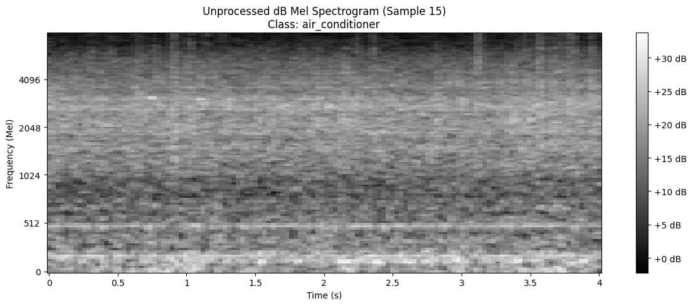
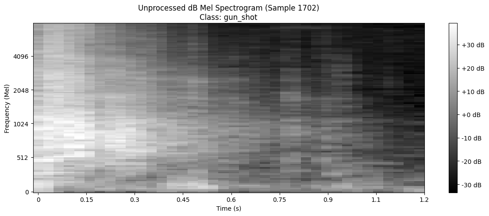
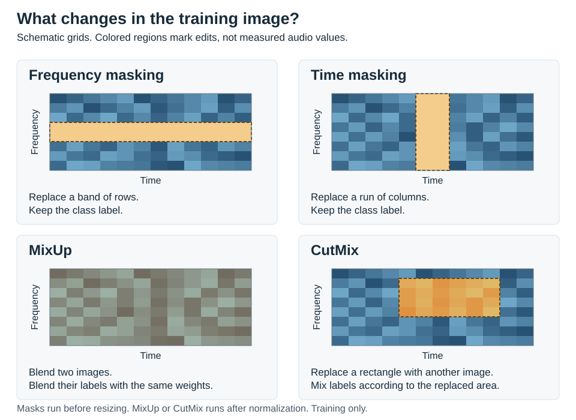
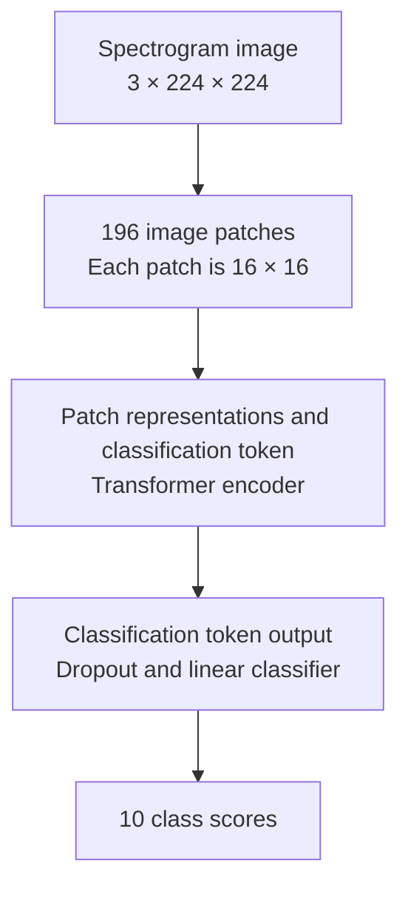
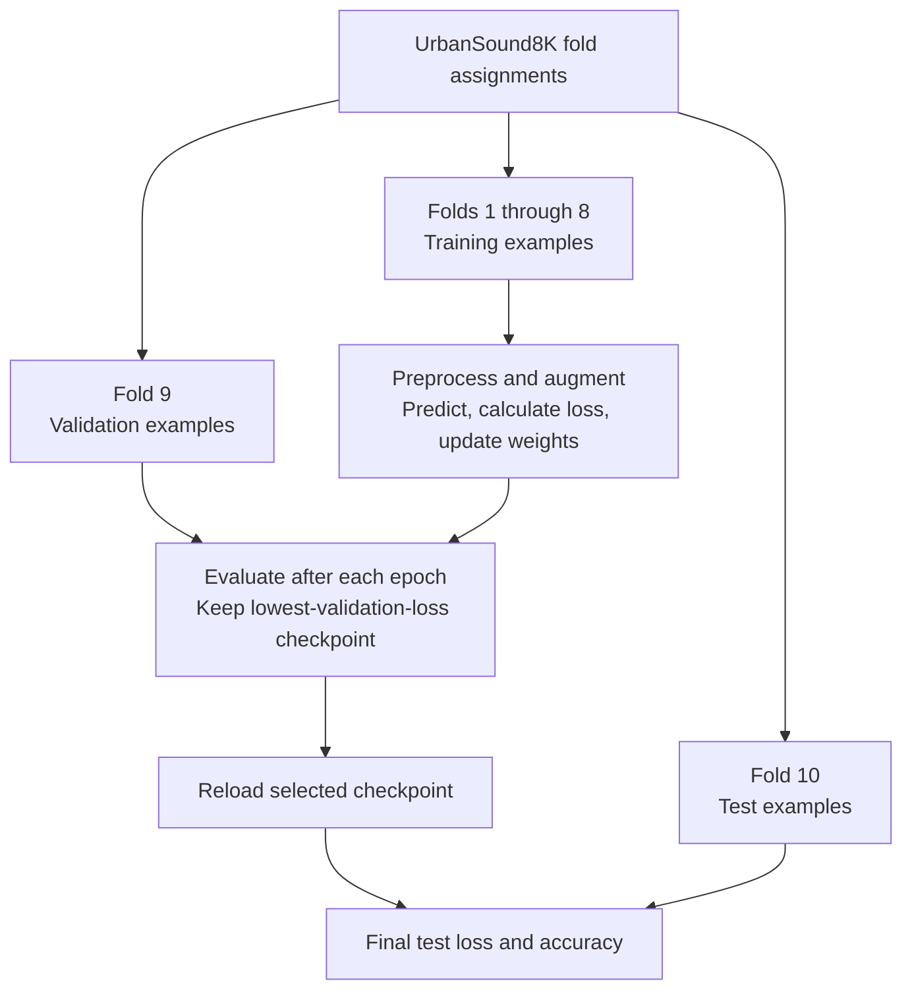
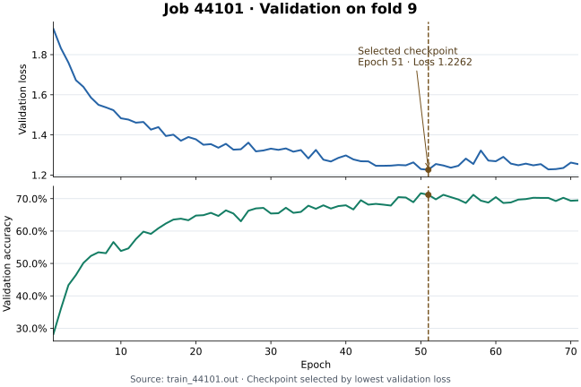

# Using an image model to classify sound

[Back to the README](../README.md)

The starting question was whether a model pretrained on images could learn to classify audio. This project tests that idea by converting sound into Mel spectrograms and fine-tuning a Vision Transformer on UrbanSound8K.

A spectrogram puts time on one axis and frequency on the other. Sound becomes a grid of values that an image model can process.

This guide explains that experiment, the transforms, and the training workflow. The [training scripts](../scripts/data.py) describe the current implementation. The [notebook](../preprocessing.ipynb) preserves exploratory code and figures, including settings that differ from those scripts.

## Why a spectrogram makes the experiment possible

An audio waveform records amplitude over time. A spectrogram describes how a sound's frequency content changes over time. That makes a brief impact, a sustained tone, and continuous background noise look different.

A Mel spectrogram groups frequency content into bands on a scale that approximates human pitch perception. The project uses 128 bands. It converts their power values to decibels to reduce the numerical range.

The hypothesis is that a pretrained image model can adapt to these patterns. The model receives no audio-specific architecture changes beyond its new classifier. Its input is an image-shaped tensor derived from audio.

That does not make a spectrogram equivalent to a photograph. A shift along the horizontal axis changes timing. A shift along the vertical axis changes frequency. Those differences matter when choosing image transforms for sound.

## What the notebook examples show

These images are existing outputs from [preprocessing.ipynb](../preprocessing.ipynb), extracted without changing their pixels.

The air-conditioner example spans about four seconds. It has frequency bands that persist across much of the clip.

The gunshot example spans about 1.2 seconds. Its energy is strongest near the beginning and fades afterward. Those observations describe the figures. They do not establish which patterns the trained model uses.

In both plots, brightness represents spectrogram power in decibels. The grayscale is a plotting choice. The training code works on tensor values rather than saved PNG files.

These are exploratory plots before frequency and time masking. Their different durations reflect the notebook's visualization code. The training scripts pad or crop every clip to four seconds.

## How a clip becomes the model input

[scripts/data.py](../scripts/data.py) performs the conversion when the dataset returns examples. It does not create a permanent folder of spectrogram images.

For a batch of size `B`, the data changes as follows.

| Stage | What happens | Result |
| --- | --- | --- |
| Decode | Read each audio array and its sample rate. | A waveform for each clip. |
| Resample and combine channels | Resample to 16,000 Hz and convert multichannel input to mono. | One sequence per clip. |
| Set the duration | Add zeros at the end of a short clip, or keep the first four seconds of a long clip. | 64,000 samples per clip. |
| Measure frequency content | Use a 2,048-sample Fourier window, a 512-sample hop, and 128 Mel bands. | A grid of frequency bands across time. |
| Convert power | Use `AmplitudeToDB(stype="power", top_db=80.0)`. | Power in decibels with an 80 dB range limit. |
| Augment training examples | Apply frequency masking and time masking. | A spectrogram with selected regions masked. |
| Match the image input | Copy the spectrogram into three channels and resize it to 224 × 224. | `[B, 3, 224, 224]`. |
| Normalize | Apply the ImageNet channel means and standard deviations. | The input tensor used by ViT. |

At 16 kHz, the Fourier window covers 128 milliseconds and the hop covers 32 milliseconds. These values control the analysis before the image resize.

The three channels initially contain copies of the same spectrogram. They are not separate microphones or different frequency ranges. Channel-specific normalization then gives the copies different offsets and scales.

The code applies ImageNet normalization directly to decibel values. It does not first map those values into the interval from zero to one. That is an implementation detail to revisit when comparing preprocessing choices.

The batch contains `pixel_values` and `labels`. Before MixUp or CutMix, labels are integer class IDs with shape `[B]`.

## What the training transforms change

The transforms make alternate training examples so that the model cannot rely on one small part of every spectrogram. Validation and test examples skip these random edits.

The colored regions explain the operations. This SVG is a schematic, not a transformed UrbanSound8K sample. Its band widths and mixing proportions are illustrative.

### Frequency masking hides a band

A horizontal region covers a range of Mel bands across time. This removes that region's original values while leaving the rest of the spectrogram available.

The current code uses `FrequencyMasking(freq_mask_param=25)`. The transform samples the mask width. The value 25 is the width parameter, not a fixed mask on every example.

### Time masking hides an interval

A vertical region covers a run of time steps across the frequency bands. The current code uses `TimeMasking(time_mask_param=40)`.

Both masks operate on the decibel spectrogram before resizing. The calls use the transforms' default fill value of zero. A masked region is therefore a region of numeric zero, not a guarantee of acoustic silence.

These operations replace image values. They do not remove samples from the original waveform or clip its amplitude.

### MixUp blends examples and labels

[scripts/engine.py](../scripts/engine.py) uses `MixUp(num_classes=10, alpha=0.2)` after it loads a training batch.

MixUp takes a weighted blend of two input tensors. It applies the same weighting to their labels. An illustrative 70% blend of example A and 30% of example B has a label with those proportions.

The model learns from that mixed target instead of a single class ID. Mixed labels contain ten class weights per example, with shape `[B, 10]`. In this implementation, mixing happens after spectrogram conversion, resizing, and normalization.

### CutMix replaces a rectangle

The engine also defines `CutMix(num_classes=10, alpha=1.0)`. CutMix replaces a rectangular region of one image with a region from another example. It mixes their labels according to the replaced area.

On a spectrogram, that rectangle covers both a frequency range and a time interval. The result is a training input, not necessarily an image of a physically recorded sound mixture.

`RandomChoice` selects either MixUp or CutMix for each training batch. It does not apply both to that batch.

### Cropping, decibel limits, and optional audio edits are different operations

Cropping keeps the first four seconds of a long waveform. Padding extends a short waveform with zeros. Neither operation randomly removes a rectangle from the image.

The `top_db=80.0` setting limits the low end of the decibel representation relative to its maximum. It does not clip peaks in the original audio waveform.

The repository also defines optional gain changes, colored noise, pitch shifts, and shifts in time. Those edits are intended to modify the waveform before spectrogram conversion.

They are inactive in the current training path. `get_datasets()` does not enable `use_time_augment`, and the augmentation block appends the original waveform before it creates the modified one. The README's [configuration limits](../README.md#current-configuration-limits) describe the related command-line behavior.

## How the Vision Transformer reads the image

[scripts/model.py](../scripts/model.py) loads torchvision's pretrained `vit_b_16`. The model's image patch size is 16 × 16 pixels.

A 224 × 224 image contains a 14 × 14 grid of patches, or 196 patches. Each patch covers part of the resized time-frequency image. The encoder also receives a classification token that it uses to summarize the image.

Attention lets patch representations exchange information across the image. The pretrained weights provide the starting point. Fine-tuning adjusts part of that model for the sound labels.

The script first freezes the pretrained parameters, replaces the original classifier with dropout of `0.5` and a ten-output linear layer, then unfreezes the last two encoder layers.

With the default configuration, the new classifier and those two layers receive weight updates. The remaining pretrained parameters stay frozen. This allows the final layers to adapt while keeping most pretrained weights fixed.

Dropout gives each classifier input a 50% chance of being zero during training. Evaluation disables dropout.

The output contains class scores. Evaluation chooses the largest score as the predicted class. The code does not produce a transcript, locate events within a clip, or predict several simultaneous labels.

The notebook's saved model summary shows the original 1,000-class image model. Its later experiments also unfreeze different numbers of layers. The ten-class head and two-layer setting above come from the current training script.

## How the training and evaluation paths connect

The dataset's supplied folds separate the roles of the examples. Folds 1 through 8 train the model, fold 9 selects the checkpoint, and fold 10 measures the selected model.

During an epoch, the model predicts the augmented training batches. Cross-entropy compares those predictions with their targets. The optimizer then updates the trainable parameters.

The current optimizer is AdamW with weight decay of `0.05`. The head learning rate is `2e-4`, and the encoder learning rate is `1e-5`. A cosine schedule changes those rates over the requested training period. The loss uses label smoothing of `0.1`. Weight decay discourages large parameter values. Label smoothing assigns some target weight to every class.

Validation uses evaluation mode without weight updates or random training transforms. The checkpoint criterion is validation loss, not the highest validation accuracy.

A lower validation loss replaces the saved checkpoint and resets the early-stopping counter. Twenty epochs without a lower loss end training. The script then reloads that checkpoint before evaluating the test split. If the checkpoint file is missing, the code falls back to the final model.

TensorBoard records training and validation loss and accuracy under `runs/urbansound8k/`. Slurm provides the cluster resources and starts the same Python training entry point. It does not define a separate model.

If the dataset lacks fold metadata, the loader uses a seeded random split instead. That fallback is a different evaluation setup.

## What the saved result answers

[Job 44101](../train_44101.out) reports test loss of `1.2032` and test accuracy of `0.7123`. It selects epoch 51 and stops after epoch 71.

The saved result supports the project's initial idea. This training run used a vision model to classify images derived from audio and reported 71.23% accuracy on the held-out fold.

It does not establish that this model is better than an audio-specific model. The repository does not contain a controlled comparison against such a baseline or an evaluation across all ten held-out folds.

It also does not isolate the contribution of each transform. That would require comparable runs that change one choice at a time.

The reported accuracy is the mean of batch accuracies. Each batch receives equal weight, including a smaller final batch. During training, accuracy compares predictions with the largest component of each mixed label, so it differs from ordinary accuracy on unmodified examples.

The logs record historical runs rather than a fully preserved experiment environment. Their requested flags differ from some current code behavior, and they do not identify the exact source revision or package versions.

## Connections to the repository

The [README](../README.md) contains setup commands and the short results table. The main sources behind this explanation are:

- [scripts/data.py](../scripts/data.py) defines the representations, dataset splits, and spectrogram transforms.
- [scripts/model.py](../scripts/model.py) defines the pretrained model and trainable layers.
- [scripts/engine.py](../scripts/engine.py) defines batch mixing, weight updates, evaluation, and checkpoint selection.
- [train.py](../train.py) connects the loaders, optimizer, model, and final test.
- [preprocessing.ipynb](../preprocessing.ipynb) contains the saved spectrogram examples and exploratory model summaries.

The [guide asset generator](generate_guide_assets.py) extracts the two notebook PNGs and creates the augmentation schematic using Python's standard library. Running `python docs/generate_guide_assets.py` from the repository root rebuilds those assets without downloading audio or model weights.
